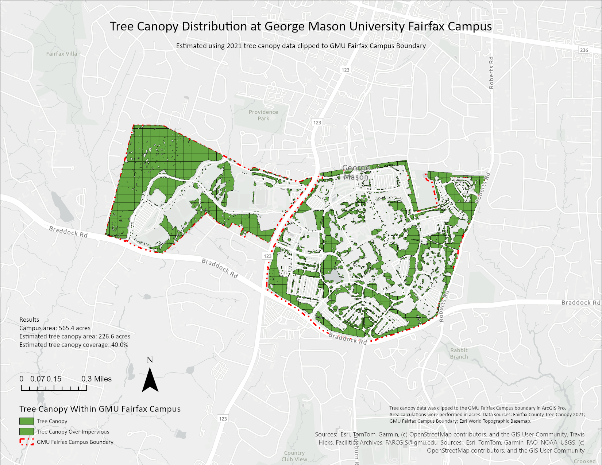

# Tree Canopy Distribution at George Mason University

## Project Overview
This project examines tree canopy distribution across
George Mason University's Fairfax campus. The objective 
was to estimate tree canopy coverage and
visualize its spatial distribution across campus.

## Tools & Technologies
- ArcGIS Pro
- Fairfax County Tree Canopy 2021 dataset
- GMU Fairfax campus boundary

## Methodology
1. Obtained 2021 tree canopy data and the campus boundary
2. Clipped the tree canopy data to the GMU Fairfax campus
3. Calculated campus and tree canopy areas
4. Estimated percentage tree canopy coverage
5. Created a thematic map with a legend, scale bar,
   north arrow, and source attribution

## Key Findings
- Total campus area: 565.4 acres
- Estimated tree canopy area: 226.6 acres
- Estimated tree canopy coverage: 40.0%

## Final Map

## Project Files
[ArcGIS Pro Project](GMU_Tree_Canopy_Analysis.aprx)

## Limitations
The canopy estimate is based on 2021 geographic data
rather than a current field inventory. The 
ArcGIS Pro project may require access to its
original geographic datasets to display all layers.
